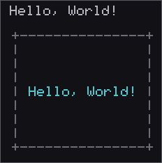

# Hello World in Some Languages

抽象度の低い言語から高い言語まで、同じ題材を並べて学べるリポジトリです。

- **Hello, World!** … 各言語の最小サンプル
- **進行波アニメ（17×9）** … 見た目は共通で、ソースの書き方だけ各言語の特徴に寄せる（C 以降）

### プレビュー

| Hello, World! | 進行波アニメ（17×9） |
|---------------|----------------------|
|  |  |

キャプチャの再生成: `python3 scripts/render_captures.py`

| 言語 | ディレクトリ | 抽象度の目安 | 各言語特有の表現 |
|------|--------------|--------------|------------------|
| 機械語 | [`machine/`](machine/) | 最も低い（CPU が実行する命令そのもの） | - 即値・アドレスの直操作<br>- ELF ヘッダをバイト列で記述<br>- `syscall` で OS を呼ぶ<br>- ジャンプで制御を組み立てる |
| アセンブリ | [`assembly/`](assembly/) | 機械語の人間向け表記 | - ニーモニックとレジスタ<br>- ラベルと分岐<br>- データ節とコード節の分離<br>- リンカで実行ファイル化 |
| C | [`c/`](c/) | 低水準・手続き型 | - `struct` と関数<br>- 配列・ポインタ走査<br>- 手続き型の分割<br>- 標準ライブラリ（`sin` など） |
| C++ | [`cpp/`](cpp/) | C にオブジェクト指向などを加えた言語 | - クラスとメンバ関数<br>- カプセル化<br>- `std::vector` / `std::string`<br>- RAII による資源管理 |
| Rust | [`rust/`](rust/) | 安全性を重視したシステム言語 | - 所有権と借用<br>- `struct` / `enum` + `match`<br>- イテレータ連結<br>- `Result` によるエラー処理 |
| Go | [`go/`](go/) | シンプルな並行処理向け言語 | - `struct` + メソッド<br>- スライスと `range`<br>- 簡潔な `for`<br>- `time.Ticker` によるフレーム更新 |
| Java | [`java/`](java/) | JVM 上で動くオブジェクト指向言語 | - クラスとメソッド中心の構成<br>- ネストクラスでの状態表現<br>- アクセス修飾子<br>- `ArrayList` など標準コレクション |
| Scala | [`scala/`](scala/) | JVM 上の関数型寄り言語 | - 不変データと式指向<br>- `case class` / パターンマッチ<br>- `map` / `zipWithIndex`<br>- 高階関数 |
| JavaScript (Node.js) | [`javascript/`](javascript/) | ランタイム上で動くスクリプト言語 | - 関数とクロージャ<br>- オブジェクトリテラル<br>- `async` / `Promise`<br>- 配列の `map` |
| PHP | [`php/`](php/) | CLI でも動くスクリプト言語 | - `declare(strict_types=1)`<br>- 配列と `array_map`<br>- クラスと readonly プロパティ<br>- `match` 式 |

## 構成

```text
machine/      Hello（hello.hex = コメント付き機械語）
assembly/     Hello（NASM）
c/            Hello + animate（手続き型）
cpp/          Hello + animate（クラス）
rust/         Hello + animate（所有権・イテレータ）
go/           Hello + animate（struct + Ticker）
java/         Hello + animate（OOP）
scala/        Hello + animate（関数型寄り）
javascript/   Hello + animate（関数・async）
php/          Hello + animate（配列・クラス・match）
docs/images/  README 用キャプチャ（hello / wave）
scripts/      キャプチャ再生成（render_captures.py）
```

各言語の生成物は `<言語>/out/` へ出力します（中身は Git 管理外、`.gitkeep` のみ残します）。JavaScript と PHP はコンパイルしないため `out/` を使いません。詳細・確認コマンドは各ディレクトリの README を参照してください。

## WSL Ubuntu の環境構築

ツールは **WSL 上の Ubuntu** に入れる想定です。まず `sudo apt update` を実行してから、必要なものを入れます。

| 言語 | 主なツール | インストール（要約） |
|------|------------|----------------------|
| [機械語](machine/) | Python 3 | `sudo apt install -y python3` |
| [アセンブリ](assembly/) | NASM, ld | `sudo apt install -y nasm binutils` |
| [C](c/) | GCC | `sudo apt install -y build-essential` |
| [C++](cpp/) | g++ | `sudo apt install -y build-essential` |
| [Rust](rust/) | rustup / cargo | 公式 `rustup` インストーラ |
| [Go](go/) | Go | `sudo apt install -y golang-go` |
| [Java](java/) | OpenJDK | `sudo apt install -y openjdk-25-jdk` |
| [Scala](scala/) | OpenJDK, Scala | `sudo apt install -y openjdk-25-jdk scala` |
| [JavaScript (Node.js)](javascript/) | Node.js | `sudo apt install -y nodejs npm` |
| [PHP](php/) | PHP CLI | `sudo apt install -y php-cli` |

## クイックスタート: Hello, World!

リポジトリ直下で実行する想定です。機械語とアセンブリは **Linux x86-64**（WSL）向けです。

```bash
# 機械語
python3 machine/to_bin.py && chmod +x machine/out/hello.bin && ./machine/out/hello.bin

# アセンブリ
nasm -f elf64 assembly/hello.asm -o assembly/out/hello.o && ld assembly/out/hello.o -o assembly/out/hello && ./assembly/out/hello

# C
gcc c/hello.c -o c/out/hello && ./c/out/hello

# C++
g++ cpp/hello.cpp -o cpp/out/hello && ./cpp/out/hello

# Rust
cargo run --manifest-path rust/Cargo.toml --bin hello

# Go
go build -C go -o out/hello . && ./go/out/hello

# Java
javac -d java/out java/Hello.java && java -cp java/out Hello

# Scala
scalac -d scala/out scala/Hello.scala && scala -cp scala/out Hello

# JavaScript (Node.js)
node javascript/hello.js

# PHP
php php/hello.php
```

## クイックスタート: 進行波アニメ（17×9）

左から右へ正弦波が伝わり、各文字が上下します。見た目は共通、実装スタイルだけが異なります。  
**Ctrl+C** で終了（カーソルを戻します）。

機械語・アセンブリには用意していません。`sin`・フレームバッファ・ANSI 制御・待機ループまで自前だと、学習用比較としては分量が大きくなりすぎるためです。

```bash
# C
gcc c/animate.c -o c/out/animate -lm && ./c/out/animate

# C++
g++ cpp/animate.cpp -o cpp/out/animate && ./cpp/out/animate

# Rust
cargo run --manifest-path rust/Cargo.toml --bin animate

# Go
go run -C go ./animate

# Java
javac -d java/out java/Animate.java && java -cp java/out Animate

# Scala
scalac -d scala/out scala/Animate.scala && scala -cp scala/out Animate

# JavaScript (Node.js)
node javascript/animate.js

# PHP
php php/animate.php
```

## 学びのポイント

下に行くほど、OS やランタイムが多くの仕事を肩代わりします。

1. **機械語** — バイト列そのものが命令（[`machine/hello.hex`](machine/hello.hex) は最小 ELF＋`write`/`exit`）
2. **アセンブリ** — 同じ処理をニーモニックで書く
3. **C** — コンパイラが機械語へ翻訳する。アニメは手続き型
4. **C++** — クラスで状態と更新をまとめる
5. **Rust** — 所有権やイテレータで安全性と変換を表現する
6. **Go** — 小さな型と Ticker でループを回す
7. **Java** — クラス／ネスト型でアニメを組み立てる
8. **Scala** — 不変データと `map` でフレームを合成する
9. **JavaScript (Node.js)** — 関数と非同期ループで同じ動きを書く
10. **PHP** — 配列とクラス、`match` で同じ動きを CLI から書く
